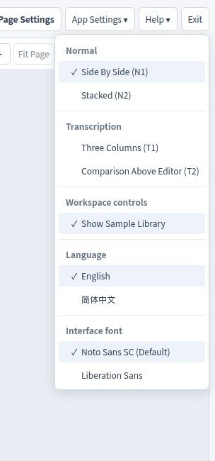
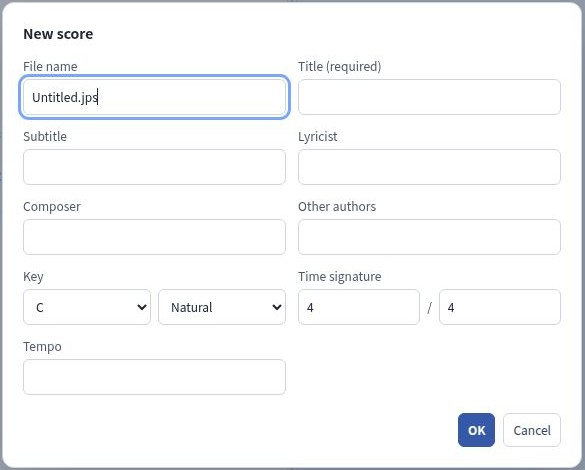
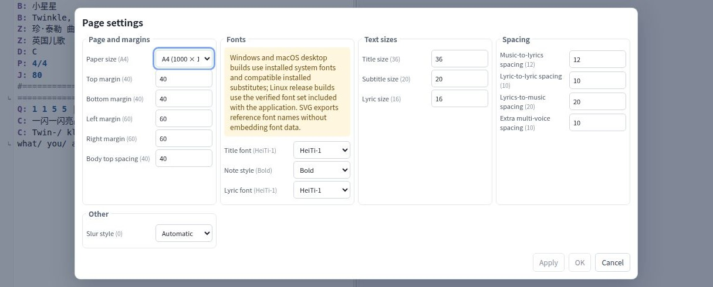
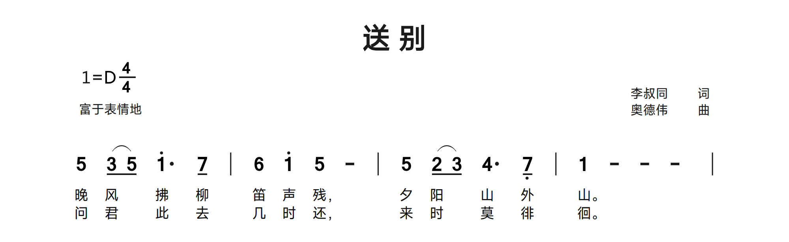

# OctoPus Quick Start

**OctoPus: Octave + Jianpu for editing numbered-notation scores.**
**章鱼简谱：玩转八度，轻松制谱。**

OctoPus (章鱼简谱) is a desktop editor for **Jianpu** — numbered musical notation. You write a
score in **JPS** (Jianpu Script), see a **live SVG preview** as you type, compare it against an
original image or PDF, and export finished pages as SVG, PDF, PNG or JPEG. Everything — editing,
rendering and transcription — runs locally on your computer.

This guide takes you from a fresh install to a finished, exported score in about ten minutes, using
the classic song **Farewell (送别)** as the running example.

> Screenshots show the Linux interface; menus and fonts may differ on your system.

---

## Contents

1. [Install and run](#1-install-and-run)
2. [Program layout, buttons and menus](#2-program-layout-buttons-and-menus)
3. [Your first score: Farewell](#3-your-first-score-farewell)
4. [Transcribing an image or PDF](#4-transcribing-an-image-or-pdf)
5. [Tuning the page layout](#5-tuning-the-page-layout)
6. [Exporting the final page](#6-exporting-the-final-page)
7. [Minimal JPS syntax cheat-sheet](#7-minimal-jps-syntax-cheat-sheet)

---

## 1. Install and run

Download the package for your operating system from the
[OctoPus releases page](https://github.com/OctaveMelody/OctoPus/releases). The bundle includes the
score examples and the offline user manual, so no internet is needed after install.

### Windows

- **Installer (recommended):** double-click `OctoPus_<version>_x64_win64_setup.exe` and follow the
  wizard. Windows needs **WebView2** (present on most machines already).
- **Portable:** unzip `OctoPus_<version>_x64_win64_portable.zip` anywhere and run
  `octopus.exe`. Keep the whole folder together — it contains the engine and examples.


### macOS

1. Open the Apple Silicon `OctoPus_<version>_arm64_macos.dmg` and drag **OctoPus** into your **Applications** folder.
2. The current DMG is **unsigned and not notarized**, so macOS may block the first launch. Open a **Terminal** window and run this command to remove the quarantine flag, then
   double-click the app again:

   ```bash
   xattr -cr /Applications/OctoPus.app
   ```

   **Why this command?** When an app is downloaded from the internet, macOS tags it with an
   extended attribute called `com.apple.quarantine`. Gatekeeper refuses to open apps whose quarantine
   flag is set unless they are signed and notarized by Apple. `xattr -cr` clears (`-c`) all
   extended attributes and recursively (`-r`) walks the app bundle, removing that tag so the app
   can start. If a warning dialog still appears, choose **Open**.

> The macOS desktop build uses your installed Apple system fonts (PingFang SC, Songti SC, …). See
> **Help → Font Status** if a character is missing.

### Linux

- **AppImage (recommended):** download `OctoPus_<version>_x64_linux.AppImage`, make it executable
  and run it:

  ```bash
  chmod +x OctoPus_*_x64_linux.AppImage
  ./OctoPus_*_x64_linux.AppImage
  ```

- **Portable:** if you have a portable build, keep its entire folder together and run
  `portable/usr/bin/octopus`. Linux needs GTK/WebKit runtime libraries and Poppler tools.

### From source (developers)

See [ENVIRONMENT.md](../ENVIRONMENT.md) for setup and commands.

---

## 2. Program layout, buttons and menus

On first use OctoPus opens the 小星星 example; a recoverable session may be restored instead.
The interface starts in Simplified Chinese. Choose **应用设置 → English** for English. The toolbar
and panes can be arranged with **App Settings**.


**Toolbar controls:**

| Button | Does this |
| --- | --- |
| **New** | Create a score using the New score dialog. |
| **Open** | Load a `.jps` score or a bundled example. |
| **Save / Save As** | Write the current document; Save As picks a new location. |
| **Import** | Bring in a JPG / PNG / PDF original for transcription. |
| **Export** | Publish the score as SVG / PDF / PNG / JPEG. |
| **Close / Exit** | Close the score / quit the app. |
| **Page Settings** | Paper, margins, fonts, sizes, spacing, slur shape. |
| **App Settings** | Layout, interface language and UI font. |
| **Help** | User Manual, Fonts, About, updates. |

**App Settings** chooses one of four working layouts and the interface language/font:



| Layout | Use |
| --- | --- |
| **Normal N1** | Source and preview side by side (default for editing). |
| **Normal N2** | Source and preview stacked. |
| **Transcription T1** | Original + source + preview, three columns (for copying from a scan). |
| **Transcription T2** | Original and preview above the source editor. |

The three panes do these jobs:


- **JPS source** — you type the plain-text JPS here. The filename and an *Unsaved* marker sit before
  the **Format Source** button.
- **SVG preview** — the rendered score, with fit/zoom/next-page controls and render diagnostics.
  It updates as you type.
- **Original Image/PDF** — the reference scan; shows in the Transcription layouts.

> 💡 In a narrow window the pane tools fold into **View** (preview) and **Edit** (source) menus on
> the pane's title row. Drag the border between panes to resize them.

---

## 3. Your first score: Farewell

Let's build the opening of **Farewell (送别)** by hand so you see how source text becomes music.

### Step 1 — New document

Click **New** (or `Ctrl/Cmd + N`). In the New score dialog, enter a title, choose the key and
meter, then click **OK**. The app creates a score with a generated header.



### Step 2 — Enter the descriptive header

The **header** describes the score: version, title, author, key, meter and tempo. Each field is a
capital letter, a colon, a space and the value. For this example, replace the generated source in the **JPS source** pane with:

```jps
V: 1.0
B: 送  别
Z: 李叔同 　　词
D: D
P: 4/4
J: 富于表情地
```

| Field | Meaning | Example here |
| --- | --- | --- |
| `V` | Script version | `1.0` |
| `B` | Title (repeat `B` for a subtitle) | `送  别` |
| `Z` | Author / credit (repeat `Z` for more lines) | `李叔同 　　词` |
| `D` | Key — a capital A–G, `#` sharp or `$` flat | `D` |
| `P` | Meter (time signature) | `4/4` |
| `J` | Tempo — a number and/or words | `富于表情地` |

> ⚠️ Use **ASCII punctuation**: a half-width colon `:`, quote `"`, comma `,`, apostrophe `'` and
> slash `/`. A full-line `#` is a comment; inside a note, `#` means sharp.

### Step 3 — Enter the first music row

A music row starts with `Q:`. A bare digit is a **quarter note**; spaces separate notes; `|` is a
barline. Add a sung row from Farewell:

```jps
Q: 5 (3/ 5/) 1'. 7/ | 6 1' 5 - | 5 (2/ 3/) 4. 7,/ | 1 - - - |
```

Read it aloud as you watch the preview render:

- `5` `6` `1'` … are scale degrees (the `'` = one octave higher; `,` would be lower).
- `3/` is an eighth note (the `/` halves the duration); `4.` is a dotted note.
- `-` extends a note (a continuation stroke). `0` is a rest; `8` is a hidden/rest slot.
- Parentheses group notes under slurs.


### Step 4 — Click a note to link source and preview

**Click a note in the SVG preview** and OctoPus highlights the matching token in the source (marked
green). Click the token in the source to jump back. This two-way link is the fastest way to edit:
find the note in the music, then fix the exact character in the text.


### Step 5 — Add the lyrics

A lyric row starts with `C:` and belongs to the `Q:` row directly above it. Chinese characters map
one-per-note; `@` skips an unsung note; punctuation is not sung.

```jps
C: 晚风@拂柳笛声残，夕阳@山外山。
```


Add more verses by copying the `C:` line and replacing the words, and more `Q:` rows to extend the
song. To try the full piece, choose **Open** and load **Farewell.jps** from the examples folder.

### Step 6 — Save your work

**Save As** (`Ctrl/Cmd + Shift+S`) to store the editable master as a `.jps` file. Follow any
prompt to preserve page settings when saving a plain-text score. Save a copy before experimenting.

> ✅ **Golden rule:** change **one token at a time**, look at the preview, and use
> `Ctrl/Cmd+Z` to undo. A successful render does not prove the music is correct; proofread it against your source.

---

## 4. Transcribing an image or PDF

OctoPus can read a scan of a Jianpu score and produce an editable **JPS draft**. Accuracy is good but
not perfect, so always proofread the draft against the original.

### Step 1 — Import the original

Click **Import → JPG / PNG / PDF…** (or drag one file into the **Original Image/PDF** pane).
Import one JPG, PNG or PDF at a time. Each file is limited to 100 MiB, with at most 200
PDF/reference pages and 40 million pixels per decoded page.


### Step 2 — Choose a transcription mode

In the Original pane, open the **Transcribe** menu:

- **Transcribe New** — recognize a whole new score (replaces the current document; save first).
- **Transcribe Append** — add recognized music to the current score. Explicit draft key, meter and tempo must match
  the current score when they can be verified; otherwise use Transcribe New.

Use a **Transcription layout (T1/T2)** from App Settings so the original, source and preview are all
visible.


### Step 3 — Find and fix recognition issues

OctoPus compares the draft against itself and lists **findings**. Click a finding in the review list:
the original pane zooms to that region and outlines it in amber, and — when the finding maps to a
single note — selects that note in the source. A low digit-agreement note gets a warning mark.


**What to check manually** (the draft never fixes these for you):

- Note numbers, **octave dots** (`'` / `,`) and **dotted durations**.
- **Accidentals** (`#` `$` `=`), **grace notes** (`1[23]`), **slurs** (`(1 2 3)`) and endings.
- **Lyrics** — count sung slots against the notes; fix `@` skips and `/` syllable breaks.
- Meter changes, page order, and any missed or extra measures.

Then edit the tokens directly in the source (see the cheat-sheet in section 7) until the preview
matches the original, and **Save**.

---

## 5. Tuning the page layout

**Page Settings** controls how the score is laid out and which fonts draw it. Open it from the
toolbar (**Page Settings**).



Main groups:

| Group | Controls |
| --- | --- |
| **Paper & margins** | A4 / A5 page; top/bottom/left/right margins and body offset. |
| **Fonts & style** | Title and lyric fonts; note style (Regular, Italic, Bold). |
| **Sizes** | Title, subtitle and lyric font sizes. |
| **Spacing** | Music-to-lyric, lyric-to-lyric, lyric-to-music and voice spacing. |
| **Slur shape** | Automatic, Arc, or Flat top. |

Buttons:

- **Apply** — update the preview now, keep the dialog open.
- **OK** — apply and close.
- **Cancel** — discard *unapplied* changes (already-applied ones stay).

> 📏 Sizes and margins are in **renderer units**, not millimeters. Font roles (HeiTi, SongTi, KaiTi,
> FangSong) pick the family for each text role; on Windows/macOS OctoPus uses the matching installed
> system font. **Save the score** to keep any setting you applied.

---

## 6. Exporting the final page

When the preview looks right, click **Export** and choose a format:


| Format | Notes |
| --- | --- |
| **SVG** | Vector; scales without pixelation. Needs matching text fonts in the viewer. |
| **PDF** | One multi-page document; embeds fonts; best for sharing/printing. |
| **PNG** | Lossless raster, one file per page. |
| **JPEG** | Compressed raster, one file per page. |

**DPI** (PNG/JPEG only): use **300 DPI** for print, **96 DPI** for screen.

- PDF creates **one** combined document; SVG/PNG/JPG create **one file per page**.
- **Save the `.jps` first** — it is your editable master. Exports are output, not something you edit
  back.

The rendered Farewell excerpt below comes from the [manual](user-manual/en.html#en-example-first-score).




---

## 7. Minimal JPS syntax cheat-sheet

JPS is plain text. A score is a **header**, then music rows (`Q:`) each followed by their lyric rows
(`C:`). Blank lines and whole-line `#` comments improve readability.

### Header

```jps
V: 1.0
B: Title
Z: Author
D: D
P: 4/4
J: 90
```

### Notes, register and duration

| Symbol | Meaning |
| --- | --- |
| `1`–`7` | Scale degrees |
| `0` | Rest (printed) |
| `8` | Hidden rest (keeps layout space, no printed digit) |
| `1'` / `1''` | One / two octaves **higher** |
| `1,` / `1,,` | One / two octaves **lower** |
| `1 - -` | Note plus extension strokes (longer) |
| `1/` `1//` `1///` | Eighth / sixteenth / thirty-second note |
| `1.` `1..` | Single / double dotted note |
| `4#` `7$` `3=` | Sharp / flat / natural (written after the digit) |

```jps
Q: 1 2 3 4 | 5. 6/ 7// 1'. - ||
```

### Barlines and repeats

| Symbol | Meaning |
| --- | --- |
| `\|` | Single barline |
| `\|\|` | Final line (thin-thick) |
| `\|\|/` | Two thin lines |
| `\:|` `\|:` `:|\|:` | End / start / both repeat |
| `\|/` `\|*` | Hidden barline (no width / reserves width) |
| `\|\|&fine` `\|&dc.` `\|&ty` | Fine / D.C. / Coda on a barline |

### Lyrics

- One Chinese character = one note. Punctuation is not sung.
- `@` skips an unsung note. `~` joins two characters into one note.
- English syllables are separated by `/`.
- Repeat the `C:` line for extra verses.

```jps
Q: 1 2 3 4 | 5 - 6 7 |
C: 春 风 @ 来 花~儿 开 了
C: 第二句也能写
```

### Handy extras (try later)

| Want… | Write… | Example |
| --- | --- | --- |
| Grace notes | `1[23]` (before) / `1[h23]` (after) | `1[2/3']` |
| Dynamics | `&mp` `&ff` `&cresc` … | `1&mp` |
| Hairpin | `<` or `>` … `!` | `1< 2 3 4!` |
| Slur / tuplet | `(1 2 3)` / `(y1 2 3)` | `(1 2 3)` |
| Ornaments | `&yc` fermata, `&dy` staccato, `&cy` trill | `3&yc` |
| Ending bracket | `\|["1" … :|]` | `\|["1" 1 2 3 :|]` |
| Page break | `[fenye]` on its own line | `[fenye]` |
| Multi-voice | `Q1:`, `Q2:` with `C1:`, `C2:` | `Q1"Soprano": 1 2 \|` |

### Where to go next

- **Full manual:** **Help → User Manual**, or open `docs/user-manual/index.html` (English & Chinese).
- **JPS spec:** <https://github.com/yetist/jianpu-spec>
- **Bundled examples:** open any `.jps` from the examples folder — a great way to copy a working
  pattern and adapt it.

---

*OctoPus is released under GPLv3. It is free software provided without warranty. For issues or
requests use **Help → Issues and Requests**.*
