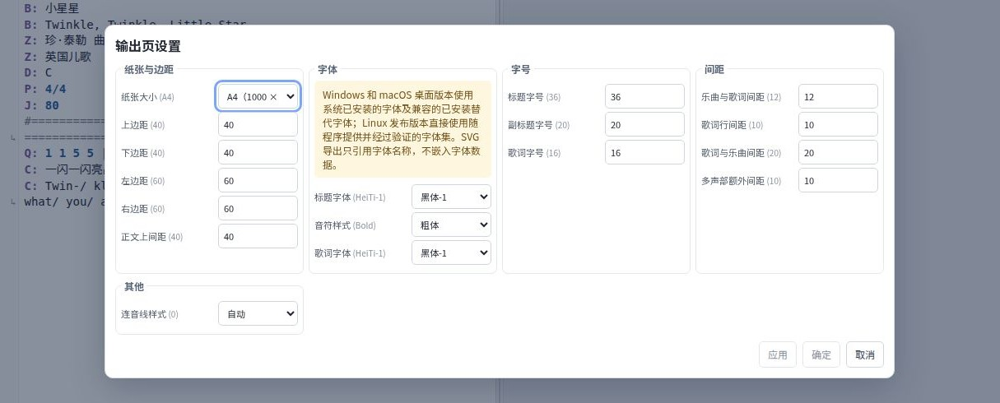

# 章鱼简谱快速上手

**OctoPus: Octave + Jianpu for editing numbered-notation scores.**
**章鱼简谱：玩转八度，轻松制谱。**

章鱼简谱（OctoPus）是一款**简谱**（数字记谱法）桌面编辑器。你用 **JPS**（Jianpu Script，简谱脚本）
编写乐谱，输入时即可看到**实时 SVG 预览**，可对照原稿图片或 PDF，并把成品导出为 SVG、PDF、
PNG 或 JPEG。编辑、渲染和转录全部在本地运行，无需联网。

本指南以经典歌曲**送别**为贯穿示例，带你从全新安装一步步走到导出成品，大约只需十分钟。

> 截图来自 Linux 界面；其他系统上的菜单和字体可能略有不同。

---

## 目录

1. [下载与安装](#1-下载与安装)
2. [程序布局、按钮与菜单](#2-程序布局按钮与菜单)
3. [你的第一张乐谱：送别](#3-你的第一张乐谱送别)
4. [转录图片与 PDF](#4-转录图片与-pdf)
5. [调整页面排版](#5-调整页面排版)
6. [导出最终成品页](#6-导出最终成品页)
7. [JPS 语法速查表](#7-jps-语法速查表)

---

## 1. 下载与安装

从[章鱼简谱发布页](https://github.com/OctaveMelody/OctoPus/releases)下载对应操作系统的安装包。
安装包里已含示例乐谱和离线用户手册，安装后无需联网。

### Windows

- **安装包（推荐）：** 双击 `OctoPus_<版本>_x64_win64_setup.exe`，按向导操作。Windows 需要
  **WebView2**（多数机器已自带）。
- **便携版：** 解压 `OctoPus_<版本>_x64_win64_portable.zip` 到任意目录，运行
  `octopus.exe`。请保持整个文件夹完整——引擎和示例都在其中。


### macOS

1. 打开 Apple Silicon 版 `OctoPus_<版本>_arm64_macos.dmg`，把 **OctoPus** 拖进「应用程序」文件夹。
2. 由于该应用目前**未签名、也未做公证**，macOS 的 Gatekeeper 可能会阻止首次启动。打开「终端」，运行
   下面这条命令清除隔离标记，然后再次双击应用：

   ```bash
   xattr -cr /Applications/OctoPus.app
   ```

   **为什么要运行这条命令？** 从互联网下载的应用会被 macOS 打上一个叫做
   `com.apple.quarantine` 的扩展属性（quarantine，隔离区）标记。除非应用由 Apple 签名并公证，
   否则 Gatekeeper 会拒绝打开带此标记的应用。`xattr -cr` 会清除（`-c`）所有扩展属性，并
   递归（`-r`）遍历整个 app 包，去掉这个标记，应用即可启动。若仍弹出警告对话框，选择「打开」
   即可。

> macOS 桌面版使用你系统里已安装的 Apple 字体（PingFang SC、Songti SC 等）。如有缺字，请查看
> 「帮助 → 字体状态」。

### Linux

- **AppImage（推荐）：** 下载 `OctoPus_<版本>_x64_linux.AppImage`，给它可执行权限后运行：

  ```bash
  chmod +x OctoPus_*_x64_linux.AppImage
  ./OctoPus_*_x64_linux.AppImage
  ```

- **便携版：** 如果已有便携构建，请保持整个文件夹完整，运行
  `portable/usr/bin/octopus`。Linux 需要 GTK/WebKit 运行库和 Poppler 工具。

### 从源码运行（开发者）

请参阅 [ENVIRONMENT.md](../ENVIRONMENT.md) 中的环境和运行说明。

---

## 2. 程序布局、按钮与菜单

首次启动时会打开《小星星》示例；如有可恢复的会话，也可能恢复上次的内容。界面默认使用简体中文。
窗口的工具栏和面板可通过 **应用设置** 安排布局。


**工具栏控件：**

| 按钮 | 作用 |
| --- | --- |
| **新建** | 通过新建乐谱对话框创建乐谱。 |
| **打开** | 打开 `.jps` 乐谱或内置示例。 |
| **保存 / 另存为** | 写入当前文档；另存为选择新位置。 |
| **导入** | 导入 JPG / PNG / PDF 原稿用于转录。 |
| **导出** | 导出为 SVG / PDF / PNG / JPEG。 |
| **关闭 / 退出** | 关闭乐谱 / 退出程序。 |
| **输出页设置** | 纸张、边距、字体、字号、间距、连音线形状。 |
| **应用设置** | 布局、界面语言、界面字体。 |
| **帮助** | 用户手册、字体、关于、检查更新。 |

**应用设置** 可在四种工作布局中选择一种，并设置界面语言与字体：


| 布局 | 用途 |
| --- | --- |
| **普通 N1** | 源码与预览左右排列（编辑时的默认布局）。 |
| **普通 N2** | 源码与预览上下排列。 |
| **转录 T1** | 原稿 + 源码 + 预览三栏排列（从扫描件抄谱时用）。 |
| **转录 T2** | 原稿与预览在上，源码编辑器在下。 |

三个面板各司其职：


- **JPS 源码** — 在这里输入纯文本 JPS。文件名和「未保存」标记位于 **格式化源码** 按钮之前。
- **SVG 预览** — 渲染后的乐谱，带适合/缩放/下一页控制和渲染诊断；输入时自动更新。
- **原稿图片/PDF** — 参考扫描稿；在转录布局中显示。

> 💡 窗口较窄时，面板工具会收进面板标题行的 **视图**（预览）和 **编辑**（源码）菜单里。
> 拖动面板之间的分隔条即可调整大小。

---

## 3. 你的第一张乐谱：送别

我们手动搭建**送别**的开头，看看源码文本如何变成音乐。

### 第 1 步 —— 新建文档

点击 **新建**（或 `Ctrl/Cmd + N`），在对话框中填写必填标题、选择调和拍号，然后点击 **确定**。
程序会生成含描述头的新乐谱。


### 第 2 步 —— 输入描述头

**描述头** 用来描述乐谱：版本、标题、作者、调性、拍号、速度。每个字段都是「大写字母 + 冒号 +
空格 + 值」。将 **JPS 源码** 面板中生成的内容替换为：

```jps
V: 1.0
B: 送  别
Z: 李叔同 　　词
D: D
P: 4/4
J: 富于表情地
```

| 字段 | 含义 | 本例 |
| --- | --- | --- |
| `V` | 脚本版本 | `1.0` |
| `B` | 标题（重复 `B` 加副标题） | `送  别` |
| `Z` | 作者/署名（重复 `Z` 加多行） | `李叔同 　　词` |
| `D` | 调性——大写字母 A–G，`#` 升、`$` 降 | `D` |
| `P` | 拍号 | `4/4` |
| `J` | 速度——数值和/或文字 | `富于表情地` |

> ⚠️ 请使用 **半角 ASCII 标点**：冒号 `:`、双引号 `"`、逗号 `,`、单引号 `'` 和斜线 `/`。
> 整行以 `#` 开头是注释；音符中的 `#` 表示升号。

### 第 3 步 —— 输入第一行音乐

音乐行以 `Q:` 开头。单个数字是**四分音符**；空格分隔音符；`|` 是小节线。加入《送别》的一行唱段：

```jps
Q: 5 (3/ 5/) 1'. 7/ | 6 1' 5 - | 5 (2/ 3/) 4. 7,/ | 1 - - - |
```

一边读，一边看预览渲染：

- `5` `6` `1'` … 是音级（`'` = 高一个八度；`,` = 低一个八度）。
- `3/` 是八分音符（`/` 把时值减半）；`4.` 是附点音符。
- `-` 延长音符（增时线）。`0` 是休止符；`8` 是隐藏/占位休止。
- 括号将音符组合在连音线下。


### 第 4 步 —— 点击音符，联动源码与预览

**在 SVG 预览里点击一个音符**，章鱼简谱会在源码中高亮对应的记号（标为绿色）。在源码里点击记号
也能跳回预览。这个双向联动是编辑的最快方式：在谱面上找到音符，再在文本里改准那个字符。


### 第 5 步 —— 添加歌词

歌词行以 `C:` 开头，属于其正上方那行 `Q:`。汉字一般一字对应一音；`@` 跳过不唱的音；标点不唱。

```jps
C: 晚风@拂柳笛声残，夕阳@山外山。
```


复制 `C:` 行再替换文字即可加第二段；再加更多 `Q:` 行扩展整首。想试完整曲，选择 **打开**，
从示例文件夹加载 **Farewell.jps** 即可。

### 第 6 步 —— 保存成果

用 **另存为**（`Ctrl/Cmd + Shift+S`）把可编辑的原稿存为 `.jps` 文件。如果保存纯文本乐谱时
程序提示保留页面设置，请按提示操作。动手尝试前先保存副本。

> ✅ **黄金法则：** 一次只改 **一个记号**，看一眼预览，用 `Ctrl/Cmd+Z` 撤销。
> 渲染成功不代表音乐内容正确，仍需对照原稿校对。

---

## 4. 转录图片与 PDF

章鱼简谱能读取简谱扫描稿，生成可编辑的 **JPS 草稿**。识别效果不错但并非完美，所以转录结果只是
一个**起点**，一定要对照原稿校对。

### 第 1 步 —— 导入原稿

点击 **导入 → JPG / PNG / PDF…**（或把单个文件拖进 **原稿图片/PDF** 面板）。支持：JPG/PNG
或 PDF，一次导入一个文件。每个文件不超过 100 MiB，PDF/原稿最多 200 页，每个解码页面
不超过 4000 万像素。


### 第 2 步 —— 选择转录模式

在原稿面板里打开 **转录** 菜单：

- **转录新建** — 识别一整份新谱（会替换当前文档；请先保存）。
- **转录追加** — 把识别到的音乐加入当前乐谱。草稿中明确写出的调性、拍号和速度须与当前乐谱
  匹配且可核验；否则请使用「转录新建」。

从应用设置选用 **转录布局（T1/T2）**，让原稿、源码、预览同时可见。


### 第 3 步 —— 查找并修复识别问题

章鱼简谱会把草稿与自身比对，列出**检查结果（findings）**。在检查列表里点一项：原稿面板会放大
到该区域并用琥珀色框标出；若该项能唯一对应到某个音符，还会在源码里选中那个音符。数字匹配度偏
低的音符会带警告标记。


**需要你人工核对的地方**（草稿不会替你修改）：

- 音数字、**八度点**（`'` / `,`）和**附点时值**。
- **变音记号**（`#` `$` `=`）、**倚音**（`1[23]`）、**连音线**（`(1 2 3)`）和跳房子。
- **歌词** —— 数一下唱词槽位与音符是否对应；修正 `@` 跳过和 `/` 分音节。
- 拍号变化、页序，以及任何漏识/多出的小节。

然后在源码里直接编辑记号（见第 7 节速查表），直到预览与原稿一致，再 **保存**。

---

## 5. 调整页面排版

**输出页设置** 控制乐谱的排版方式和绘制字体。从工具栏打开（**输出页设置**）。



主要分组：

| 分组 | 控制项 |
| --- | --- |
| **纸张与边距** | A4 / A5 纸张；上/下/左/右边距及正文起始位置。 |
| **字体与样式** | 标题和歌词字体；音符样式（常规、斜体、粗体）。 |
| **字号** | 标题、副标题、歌词字号。 |
| **间距** | 曲到词、词到词、词到曲及声部间距。 |
| **连音线形状** | 自动、圆弧、平顶。 |

按钮：

- **应用** — 立即更新预览，保持对话框打开。
- **确定** — 应用并关闭。
- **取消** — 放弃*尚未应用*的修改（已应用的不受影响）。

> 📏 字号和边距用的是**渲染器单位**，不是毫米。字体角色（黑体、宋体、楷体、仿宋）为每个文本角色
> 选择字族；在 Windows/macOS 上，章鱼简谱使用对应的已安装系统字体。**应用设置后请保存乐谱**
> 才能保留这些设置。

---

## 6. 导出最终成品页

预览满意后，点击 **导出** 并选择格式：


| 格式 | 说明 |
| --- | --- |
| **SVG** | 矢量；缩放时不会像位图一样出现像素。查看器需有匹配字体。 |
| **PDF** | 一份多页文档；嵌入字体；最适合分享/打印。 |
| **PNG** | 无损位图，每页一个文件。 |
| **JPEG** | 压缩位图，每页一个文件。 |

**DPI**（仅 PNG/JPEG）：打印用 **300 DPI**，屏幕显示用 **96 DPI**。

- PDF 生成**一份**合并文档；SVG/PNG/JPG 每页生成**一个文件**。
- **先保存 `.jps`** —— 它才是你可编辑的原稿；导出物是成品，不能再导回编辑。

下图是[用户手册](user-manual/zh-CN.html#zh-CN-example-first-score)中《送别》的渲染片段。


---

## 7. JPS 语法速查表

JPS 是纯文本。一份乐谱由**描述头**开始，其后是音乐行（`Q:`），每行 `Q:` 后面跟它的歌词行
（`C:`）。空行和整行 `#` 注释用于提升可读性。

### 描述头

```jps
V: 1.0
B: Title
Z: Author
D: D
P: 4/4
J: 90
```

### 音符、音区与时值

| 符号 | 含义 |
| --- | --- |
| `1`–`7` | 音级 |
| `0` | 休止符（显示） |
| `8` | 隐藏休止（保留排版空间，不显示数字） |
| `1'` / `1''` | 高一个 / 两个八度 |
| `1,` / `1,,` | 低一个 / 两个八度 |
| `1 - -` | 音符加增时线（更长） |
| `1/` `1//` `1///` | 八分 / 十六分 / 三十二分音符 |
| `1.` `1..` | 单附点 / 双附点 |
| `4#` `7$` `3=` | 升 / 降 / 还原（写在数字之后） |

```jps
Q: 1 2 3 4 | 5. 6/ 7// 1'. - ||
```

### 小节线与反复

| 符号 | 含义 |
| --- | --- |
| `\|` | 普通小节线 |
| `\|\|` | 终止线（左细右粗） |
| `\|\|/` | 双细线 |
| `\|:` `\:|` `:|\|:` | 起始 / 结束 / 两侧反复 |
| `\|/` `\|*` | 隐藏小节线（不占位 / 保留宽度） |
| `\|\|&fine` `\|&dc.` `\|&ty` | 小节线上的 Fine / D.C. / Coda |

### 歌词

- 一个汉字 = 一个音符。标点不唱。
- `@` 跳过不唱的音。`~` 把两个字并为一个音。
- 英文音节用 `/` 分隔。
- 重复 `C:` 行加更多段落。

```jps
Q: 1 2 3 4 | 5 - 6 7 |
C: 春 风 @ 来 花~儿 开 了
C: 第二句也能写
```

### 进阶用法（稍后再试）

| 想要… | 写… | 示例 |
| --- | --- | --- |
| 倚音 | `1[23]`（前）/ `1[h23]`（后） | `1[2/3']` |
| 力度 | `&mp` `&ff` `&cresc` … | `1&mp` |
| 渐强/渐弱 | `<` 或 `>` … `!` | `1< 2 3 4!` |
| 连音线 / 多连音 | `(1 2 3)` / `(y1 2 3)` | `(1 2 3)` |
| 装饰记号 | `&yc` 延长、`&dy` 顿音、`&cy` 颤音 | `3&yc` |
| 跳房子括号 | `\|["1" … :|]` | `\|["1" 1 2 3 :|]` |
| 分页 | 单独一行 `[fenye]` | `[fenye]` |
| 多声部 | `Q1:`、`Q2:` 配 `C1:`、`C2:` | `Q1"Soprano": 1 2 \|` |

### 继续深入

- **完整手册：** **帮助 → 用户手册**，或打开 `docs/user-manual/index.html`（中英文版）。
- **JPS 规范：** <https://github.com/yetist/jianpu-spec>
- **内置示例：** 从示例文件夹打开任意 `.jps`——抄一个可用的写法再改造，是最佳学习方式。

---

*章鱼简谱基于 GPLv3 发布，是免费软件，不提供任何担保。问题反馈或使用请求请通过
**帮助 → 问题与建议**。*
